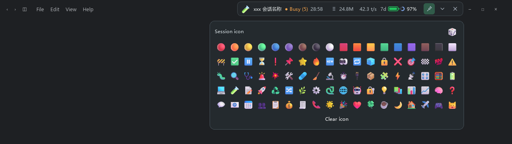

# Codex Session Bar

**Codex 桌面端的轻量会话悬浮条：一眼看进度，一键切会话。**

把当前会话、Token 用量、生成速度和剩余额度放进标题栏空白处。多任务运行时，随时查看哪些会话还在忙，快速回到想看的聊天。


| 实时掌握进度 | 快速切换会话 | 自定义会话图标 |
| :--- | :--- | :--- |
| 状态、耗时、Token、TPS、额度 | 最近 10 个会话，Busy 优先 | 90 个彩色图标，便于识别 |

## 01 · 进度与额度，一条看全


- **正在忙几个？** 橙色 `Busy (5)` 显示运行中的会话数量。
- **用了多少、跑得多快？** 同行显示当前会话累计 Token、输出 `t/s` 和本轮耗时。
- **还能用多少？** SVG 电池展示剩余额度，旁边圆环提示距离重置的进度。
- **随窗口走。** 自动跟随当前聊天和 Codex 窗口的移动、隐藏与恢复；支持拖动和置顶。

## 02 · 多个会话，点开就切

点击悬浮条上的**会话名称**，展开 Recent chats。


- **Busy 优先显示**，用橙色状态和底色区分；右端显示完成、等待等状态。
- **一行看完指标**：运行中会话显示速度、累计 Token 和持续时间；顶部汇总全部已扫描 Busy 会话的速度与 Token。
- **后台预加载**，点击即可显示已有列表；点击任意条目切到对应会话。
- **选择时不跳动**：列表打开期间固定条目顺序，状态和数值继续更新；关闭后再打开，才按最新状态排序。

## 03 · 给会话一个容易认的图标

点击悬浮条左端图标，即可展开完整选择面板，修改当前会话的图标。



**90 个图标可选，也可一键清除。** 点击右上角 **🎲**，随机换成一个不同的图标；悬停提示 `Random icon`。修改会同步到 Codex 的会话标题；切换聊天时，悬浮条上的图标一起变化。

> 图片为界面演示，标题栏使用“xxx 会话名称”和示例速率，不包含个人聊天记录。

## 快速开始

需要 **Windows 10/11、Python 3.10+、Node.js、已登录的 Codex Desktop**，以及可用的 Codex CLI 和桌面自带的 App Tools 插件。Python、Node.js 和 Codex CLI 应能从命令行启动。

**1. 获取项目**

```powershell
git clone https://github.com/frankfoxy/codex-session-bar.git
cd codex-session-bar
```

**2. 安装依赖**

```powershell
python -m pip install --no-cache-dir -r requirements.txt
```

**3. 启动**

打开 Codex，然后双击 **Launch.cmd**。默认英文、单行显示，自动跟随当前聊天。

### 可选：登录后自动启动

```powershell
powershell -NoProfile -ExecutionPolicy Bypass -File .\Enable-Autostart.ps1
```

Codex 关闭时工具在后台等待，重新打开后自动出现。点击 `×` 会退出本次运行；再次双击 Launch.cmd 可打开。取消自启动可在 Windows 任务计划程序中删除 `Codex Session Bar` 任务。

## 日常操作

| 点击位置 | 操作 |
| :--- | :--- |
| 左端图标 | 更换或清除当前会话图标 |
| 会话名称 | 打开最近会话列表，点击条目切换 |
| 中间六点手柄 | 拖动悬浮条 |
| 图钉 | 开关置顶 |
| 向下箭头 | 查看详情、开关 Follow current chat、恢复标题栏停靠 |
| `×` | 退出悬浮条 |

## 数字怎么看

| 指标 | 含义 |
| :--- | :--- |
| `27.2M` / `TOK` | 会话累计 Token，包含重复发送的上下文；不是费用金额 |
| `t/s` | 最近保存样本的输出 Token 速度，包含采样间的工具和网络等待 |
| `Busy (N)` / `Total` | 全部已扫描的本地 Busy 主会话，可能多于列表中的 10 条 |
| 电池百分比 | 账户共享的剩余额度 |
| `—` / `*` | 数据暂不可用 / 数据不完整或沿用缓存，悬停可查看说明 |

本项目是独立的 Windows 伴随工具。Codex 更新可能影响兼容性；出现无法识别当前聊天或连接失败时，会明确提示。

[开发与故障排查](DEVELOPMENT.md) · [参与贡献](CONTRIBUTING.md)
