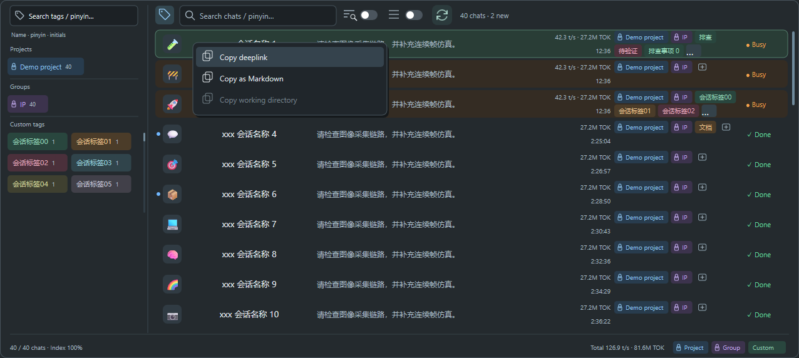
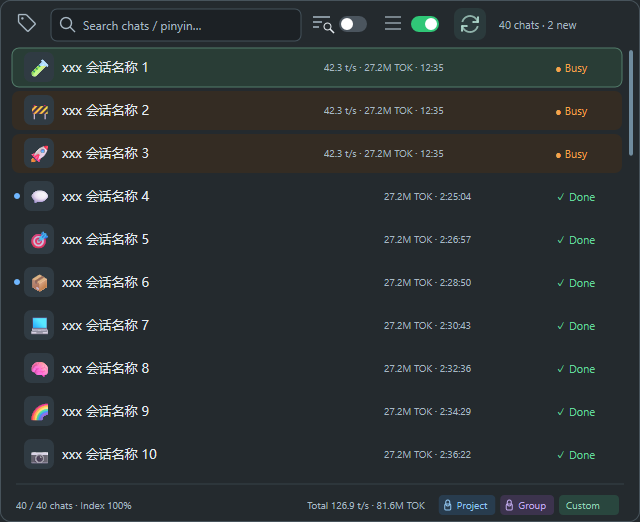
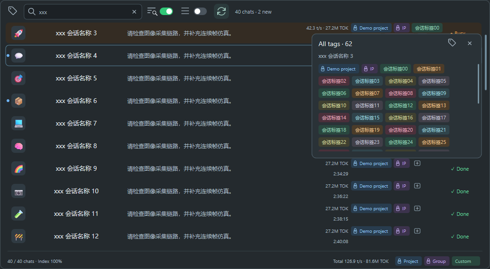
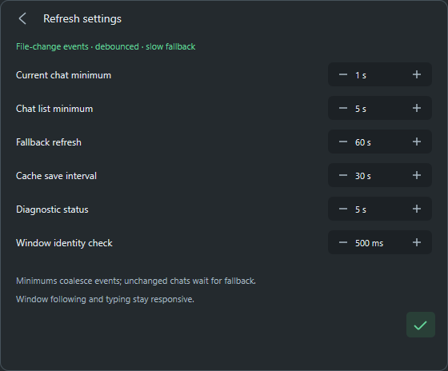

# Codex Session Bar

**Codex 桌面端的轻量会话悬浮条：一眼看进度，一键切会话。**

**默认停靠在 Codex 标题栏的空白区中央**，自动避开左侧菜单和右侧窗口按钮。当前会话、Token、生成速度和剩余额度，一行看全；窗口移动、最小化和恢复时，悬浮条一起跟随。

**v0.1.0 · Rust 原生 Windows 版** · 运行不需要 Python 或 Qt · 中文使用微软雅黑，支持多屏 DPI 缩放。


空间足够时自动居中停靠；窗口过窄时移到标题栏下方，避免遮挡操作区域。也可以拖动调整位置，在会话详情中点击停靠图标恢复自动位置。

| 实时掌握进度 | 快速切换会话 | 自定义会话图标 |
| :--- | :--- | :--- |
| 状态、耗时、Token、TPS、额度 | 本地会话搜索与滚动选择 | 完整 Emoji、分类、随机与标题推荐 |

**新增会话搜索**：支持中文、英文、全拼及拼音首字母，可选 **Body 正文搜索**。[查看更新说明](CHANGELOG.md)。

## 01 · 进度与额度，一条看全


- **正在忙几个？** 橙色 `Busy (5)` 显示运行中的会话数量。
- **有新结果？** 会话名称旁的蓝色圆点提示有已完成但未查看的会话，点击圆点展开列表；悬停显示数量。
- **用了多少、跑得多快？** 同行显示当前会话累计 Token、输出 `t/s` 和本轮耗时。
- **还能用多少？** 矢量电池展示剩余额度：75% 起绿色、50% 起蓝色、25% 起橙色、低于 25% 红色；旁边圆环提示距离重置的进度。
- **随窗口走。** 自动跟随当前聊天和 Codex 窗口的移动、隐藏与恢复；新会话先显示页面标题，指标加载后自动补齐。支持拖动，始终置顶。

## 02 · 多个会话，点开就切

点击悬浮条上的**会话名称**，或按默认快捷键 **Ctrl + Alt + J**，展开或收起会话列表；快捷键也能恢复隐藏的悬浮条，可在设置中修改或关闭。

**详细模式**：会话名称、最近提问、统计、Tag 分列展示；名称独立居中，名称和摘要最多两行，Tag 列也最多两行。


- **最近使用优先**，只列出本机有可读正文缓存或日志的会话，不显示只有元数据的记录。支持滚轮、拖动滚动条和方向键浏览；Busy 用橙色状态和底色区分。
- **每屏默认 10 行**，可在设置中调为 4–20 行；屏幕空间不足时自动适配，全部会话仍可滚动查看。
- **新完成标记**：每行最左侧、会话图标前的蓝色圆点表示有未查看的新结果，与以前已查看的 Done 区分。标记同步 Codex 的未读状态，打开对应会话后自动清除；仅展开列表或固定监看不会将结果标为已读。搜索和固定会话选择中也保留圆点。
- **输入即筛选**：支持中文、英文、全拼、拼音首字母及多音字，多个关键词用空格分隔，支持部分名称匹配。
- **紧凑图标工具栏**：文字与放大镜表示 **Body 正文搜索**，环形箭头用于刷新额度；鼠标悬停显示独立文字提示。正文开关默认关闭，开启后搜索用户与助手文字。
- **正文摘要与高亮**：正文命中的会话在摘要列显示关键词附近的内容，命中词用暖色加粗高亮，保留原文大小写。正文搜索支持多个关键词。
- **搜索结果排序**：Busy 优先 → 名称匹配 → 正文匹配，各组按最近使用时间倒序。正文命中内容保留关键词高亮。
- **后台增量索引**：启动后自动预建索引，Body 关闭时仍会继续，状态栏按本机会话数量显示百分比，完成后为 **Index 100%**。
- **独立统计列**：运行中会话显示速度、累计 Token 和本轮持续时间；其他会话显示累计 Token 和各轮已结束任务的总运行时长（不含轮次之间的空闲时间，缺失记录显示 `—`）。右下角汇总 Busy 会话的速度与 Token。
- **后台预加载**，点击即可显示已有列表；点击会话名称切换，点击图标编辑图标。
- **选择时不跳动**：列表打开期间固定条目顺序和滚动位置，状态和数值继续更新；关闭后再打开，才按最新使用时间排序。
- **右键复制**：在会话行上右键，复制会话链接、Markdown 正文或工作目录。正文从本机记录在后台生成，不调用网络；单次最多 16 MiB，超限会提示并保留剪贴板原内容。无工作目录时禁用该项。复制后保留列表与筛选。



**紧凑模式**：点击正文搜索旁的紧凑开关，只保留一行会话与指标，隐藏摘要和 Tag，适合较窄窗口。



**Tag 筛选**：标签按钮展开左侧筛选面板，默认收起。约 120 毫秒的短过渡只展开左侧区域，会话列表、会话搜索框与操作按钮保持屏幕位置；连续点击可反向收起。Tag 搜索与会话搜索并排，均支持名称和拼音，并提供清除按钮。


工程、分组标签从 Codex 同步，分别使用蓝色、紫色并保持只读；可添加自定义标签与配色。三类标签分别滚动，Projects 区域优先分配空间，高度上限为 224 DIP；分组与自定义标签各为 128 DIP。多个已选标签需同时匹配。

Tag 列最多显示两行，放不下时在最后一个可见标签后显示 **…**；点击悬浮查看全部标签，可滚动、筛选或进入编辑，保留列表的搜索与滚动位置。



**正文搜索**：命中的内容在摘要列显示并高亮。


需要持续盯住一个会话时，在详情里点击 **Choose a fixed chat…**。彩色 Emoji 和状态帮助区分会话，支持搜索、滚轮浏览及方向键选择；确认后关闭自动跟随，固定显示选定会话。


## 03 · 给会话一个容易认的图标

点击悬浮条左端图标，修改当前会话的图标。也可直接点击 Recent 或固定会话列表中的图标：选择面板贴近所点会话的图标悬浮，优先出现在右下方，空间不足时自动避让；覆盖现有界面，不撑宽列表；选完图标、按 Esc 或返回列表后，搜索条件、滚动位置及选中项都保留。


**首屏是“默认集合”**：保留原来的 90 个常用图标及排列顺序。下拉选择 **All emoji** 可浏览 Unicode Emoji 18.0 全集的 3,972 个图标与组件，也可选择其他分类。输入英文名称或 Emoji 时，始终搜索完整图标库，包含肤色、国旗和组合 Emoji；清空搜索后恢复原分类。

点击最左边 **🎲** 随机换成不同的图标；旁边的魔杖按钮会按会话标题推荐图标，例如相机、FPGA、内存或系统修复，使用本地关键词匹配。橡皮按钮清除图标。所有操作按钮均有悬停提示。修改会同步到 Codex 的会话标题；切换聊天时，悬浮条上的图标一起变化。新 Emoji 的显示取决于系统字体。

> 图片由当前原生绘制代码生成，使用虚构会话和示例数值，不包含个人聊天记录；标题栏背景为停靠位置示意。

## 04 · 设置与扩展（当前源码新增）


点击悬浮条最右侧的**齿轮**打开 **Settings**，右上角显示当前版本。下拉箭头保留会话详情，扩展功能集中放在设置最下方。

界面标签、输入提示、悬停提示、设置及右键菜单支持中文和英文，优先跟随 Codex 界面提供的语言信息，读取不到时使用 Windows 界面语言；其他语言暂使用英文。会话标题、正文及用户标签保留原文。

- **列表行数**：使用减号、加号调整可见行数。
- **名称列宽**：调整详细模式的名称列最大宽度（140–280 DIP），长标题最多两行。
- **刷新策略**：点击时钟图标打开刷新设置。数据库和日志由异步变化通知触发，合并密集事件；可调整当前会话/列表的最小间隔、低频兜底、缓存落盘、诊断输出与窗口识别间隔，应用后生效。
- **快捷键**：点击按键输入框后按下组合键，支持 Ctrl / Alt 搭配字母、数字或 F 键；可独立关闭。点击右下角 **✓** 应用并保存，发生冲突时保留原快捷键。
- **隐藏或退出**：设置底部及托盘菜单提供入口；隐藏后可通过托盘图标或已启用的快捷键恢复。恢复默认按钮会重置行数和快捷键，应用后生效。

**Extensions（扩展）** 中的 **Codex Git memory protection** 默认开启，每 **5 秒**检查一次，预设 **64 个进程 / 合计 4 GiB**，无需填写参数。

防护由独立的 Memory Watch 伴随程序执行。超限时弹出警告、记录原因，并自动结束已验证由 Codex 启动的异常 Git 查询进程；提交、推送等写操作及归属不明的进程会跳过。后端未启动或状态失联时明确提示，不会显示为已生效。

普通内存日志仍每 30 秒采样，暂停记录也会继续防护。[查看防护范围与日志](companion/memory-watch/README.md)。这项功能包含在当前源码构建及后续发布包中，已发布的 `v0.1.0` 下载包不包含此项。

当前的状态、耗时和 Token 用于观察运行情况，不代表任务完成百分比。Codex 的计划步骤状态仅在代理提供结构化计划时可用，不能据此可靠预测整个任务的剩余时间。



## 快速开始

运行需要 **Windows 10/11、Node.js、已登录的 Codex Desktop**，以及桌面自带的 App Tools 插件。无需安装 Python、Qt 或额外的 Codex CLI。

### 下载即用（推荐）

到 [v0.1.0 发布页](https://github.com/frankfoxy/codex-session-bar/releases/tag/v0.1.0) 下载 **codex-session-bar-0.1.0-windows-x64.zip**，解压到固定目录，打开 Codex 后双击 **Launch.cmd**。无需编译；可用同页的 `SHA256SUMS.txt` 校验下载文件。GitHub 的 **Source code** 附件是源码包。

### 从源码构建

需要 **Rust MSVC 工具链和 Visual Studio C++ Build Tools**。

**1. 获取项目**

```powershell
git clone https://github.com/frankfoxy/codex-session-bar.git
cd codex-session-bar
```

**2. 构建原生程序**

```powershell
powershell -NoProfile -ExecutionPolicy Bypass -File .\Build.ps1
```

**3. 启动**

打开 Codex，然后双击 **Launch.cmd** 或 **bin\codex-session-bar.exe**。默认英文、单行显示，自动跟随当前聊天。首次启动停留在首页时，也能查看额度、Busy 汇总和最近会话。

### 可选：登录后自动启动

```powershell
powershell -NoProfile -ExecutionPolicy Bypass -File .\Enable-Autostart.ps1
```

Codex 关闭时工具在后台等待，重新打开后自动出现。安装时也会安装“打开会话条”技能。取消自启动可在 Windows 任务计划程序中删除 `Codex Session Bar` 任务。

### 收起后怎么打开？

- 在齿轮设置中点击 **Hide to tray** 图标，或从托盘菜单选择同名操作，后台继续运行。
- 点击托盘里的 **Codex Session Bar** 图标，或右键选择 **Open session bar**，即可恢复。
- 在 Codex 对话里说 **“打开会话条”**，或使用 **`$codex-session-bar`**；安装技能后可恢复隐藏的工具条，也可重新启动已退出的工具条。新技能可能需要在新的对话中调用。
- 需要完全退出时，在托盘菜单或详情面板选择 **Quit session bar**。

## 日常操作

| 点击位置 | 操作 |
| :--- | :--- |
| 左端图标 | 更换或清除当前会话图标 |
| 会话名称 | 打开最近会话列表，点击条目切换 |
| 中间六点手柄 | 拖动悬浮条 |
| 向下箭头 | 查看详情、开关 Follow current chat、恢复标题栏停靠 |
| 右端齿轮 | 设置列表行数、快捷键及扩展功能；可隐藏到托盘 |
| 托盘图标 | 打开悬浮条；右键菜单可完全退出 |

## 数字怎么看

| 指标 | 含义 |
| :--- | :--- |
| `27.2M` / `TOK` | 会话累计 Token，包含重复发送的上下文；不是费用金额 |
| `t/s` | 最近保存样本的输出 Token 速度，包含采样间的工具和网络等待 |
| `Busy (N)` / `Total` | 全部已扫描的本地 Busy 主会话，不受列表当前可见条数限制 |
| 电池百分比 | 账户共享的剩余额度 |
| `—` / `*` | 数据暂不可用 / 数据不完整或沿用缓存，悬停可查看说明 |

本项目是独立的 Windows 伴随工具。Codex 更新可能影响兼容性；出现无法识别当前聊天或连接失败时，会明确提示。

[开发与故障排查](DEVELOPMENT.md) · [参与贡献](CONTRIBUTING.md) · [打包与发布](RELEASING.md)

Emoji 数据来自 [Unicode 官方 Emoji 数据](https://unicode.org/Public/emoji/latest/)，许可见 [UNICODE-LICENSE.txt](UNICODE-LICENSE.txt)。
