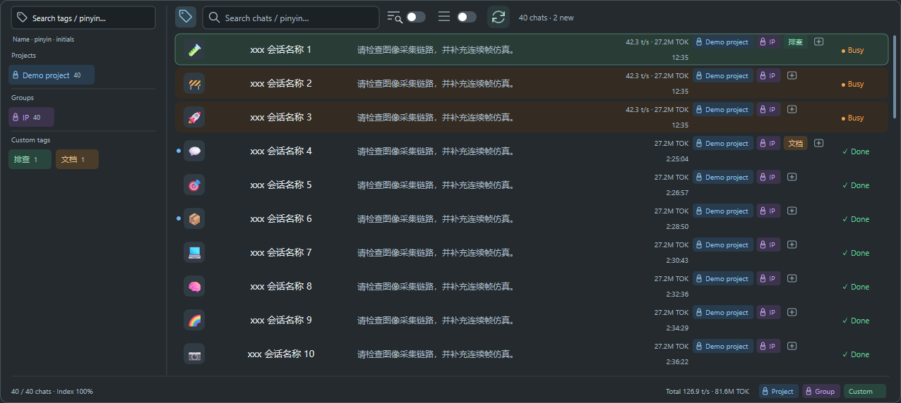
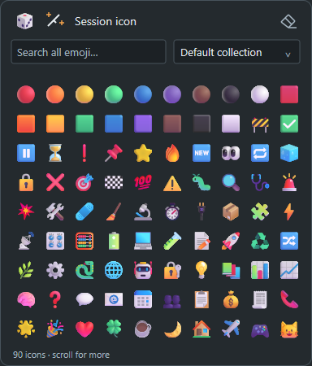
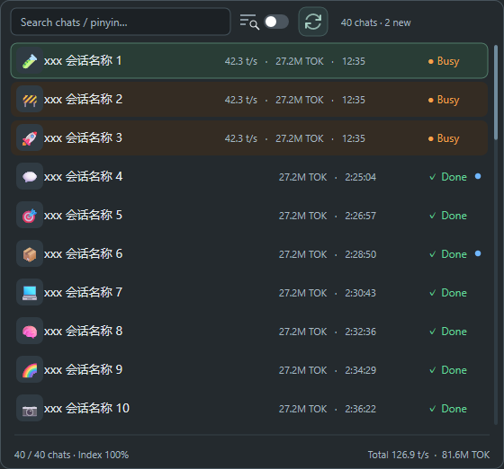
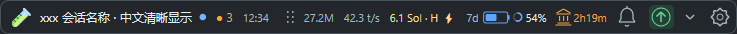

# Codex Session Bar

**用 Tag 整理 Codex 会话，给每个会话设置专属图标。**

一个 Rust 原生 Windows 会话悬浮条，支持标签筛选、快速切换与实时状态查看，默认停靠在 Codex 标题栏中央。

**稳定版：[v0.2.1](https://github.com/frankfoxy/codex-session-bar/releases/tag/v0.2.1)** · 无需 Python 或 Qt

## 用 Tag 管理会话

**把 Codex 原有的项目和分组，直接作为 Tag 使用。**

- **项目名称 → Project Tag**：自动同步，使用蓝色标签。
- **分组名称 → Group Tag**：自动同步，使用紫色标签。
- **自定义 Tag**：为会话添加自己的标签与配色，例如“排查”“文档”“待验证”。

项目、分组标签的名称跟随 Codex 同步，配色固定，在会话条中只读；自定义标签可自由管理。每个会话可以带多个 Tag，点选标签即可组合筛选，标签名称支持中文、英文、全拼和拼音首字母搜索。

左侧筛选面板默认收起，展开时会话列表保持原位；详细列表直接展示会话已有的标签，方便跨项目、跨分组查找。



## 给每个会话加一个图标

**为每个会话设置容易辨认的 Emoji，让相似标题也能一眼区分。**

点击会话列表中的图标即可修改，也可以点击悬浮条左端图标。支持完整 Emoji 图标库搜索、分类浏览、随机选择，以及根据会话标题推荐图标。

图标会同步到 Codex 会话名称，并在悬浮条与会话列表中显示；选择图标后仍留在原列表，继续浏览或修改其他会话。



## 还有这些实用功能

- **快速找会话**：名称支持中文、英文和拼音搜索；可选正文搜索，显示并高亮匹配内容。
- **两种列表模式**：详细模式展示最近提问、统计与标签；紧凑模式只保留一行。
- **实时状态**：查看 Busy 会话数量、耗时、Token、生成速度和账户剩余额度；蓝点标记新完成、未查看的结果。
- **快捷操作**：默认 `Ctrl + Alt + J` 打开会话列表，仅在 Codex 或会话条获得焦点时生效；右键可复制会话链接、Markdown 或工作目录。
- **可配置**：齿轮中调整列表、快捷键与刷新策略；界面和提示跟随 Codex 的中文或英文设置。





## 快速开始

1. 到 [v0.2.1 发布页](https://github.com/frankfoxy/codex-session-bar/releases/tag/v0.2.1) 下载 **codex-session-bar-0.2.1-windows-x64.zip**，解压到固定目录。
2. 打开并登录 Codex Desktop，双击 **Launch.cmd**。
3. 点击悬浮条的会话名称打开列表，点击标签按钮筛选，点击会话图标设置图标。

运行需要 **Windows 10/11、Codex Desktop 的 App Tools 插件与可用的 Node.js 运行时**；程序会自动查找 Codex 附带的运行时。收起后可点击托盘图标恢复；需要登录后自动启动时，运行 **Enable-Autostart.ps1**。

从源码构建需要 Rust MSVC 和 Visual Studio C++ Build Tools，在仓库目录运行：

```powershell
powershell -NoProfile -ExecutionPolicy Bypass -File .\Build.ps1
```

[更新说明](CHANGELOG.md) · [开发与故障排查](DEVELOPMENT.md) · [参与贡献](CONTRIBUTING.md) · [打包与发布](RELEASING.md)

截图使用示例会话与数值。本项目是独立的 Codex 伴随工具。Emoji 数据来自 [Unicode](https://unicode.org/Public/emoji/latest/)，许可见 [UNICODE-LICENSE.txt](UNICODE-LICENSE.txt)。
