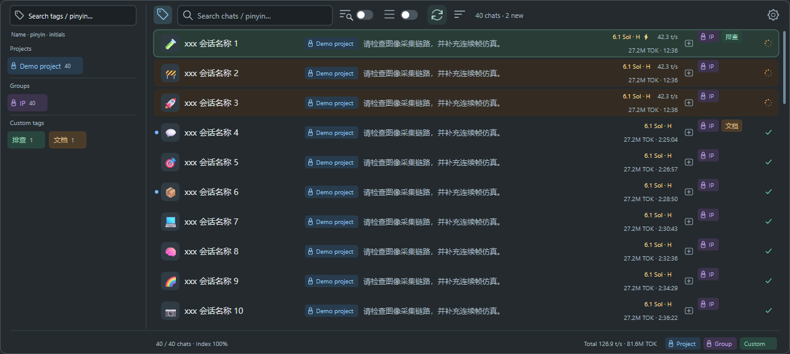
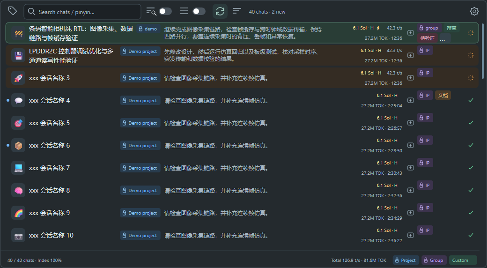
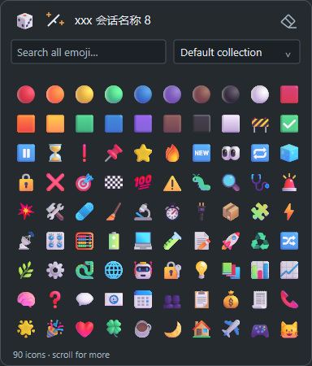
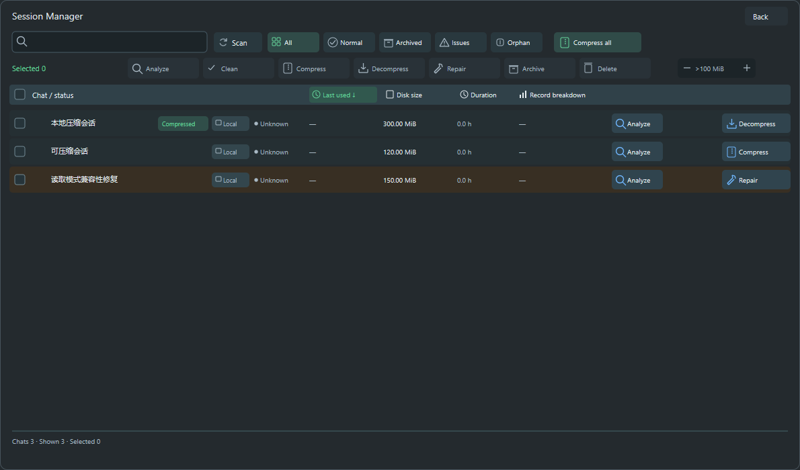
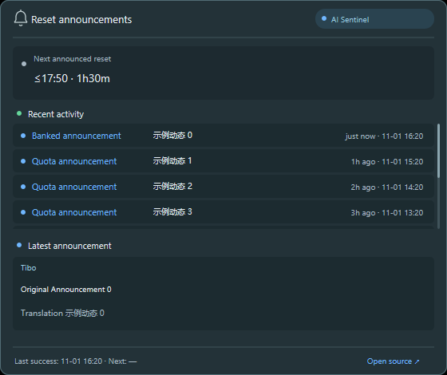

# Codex Session Bar

**用 Tag 管理 Codex 会话，给每个会话设置专属图标。**

Windows 原生会话工具栏：在 Codex 标题栏查看状态、搜索和切换会话，也可以在 Codex 关闭后独立查看本地会话。

**当前源码：v0.5.2** · [稳定版 v0.5.1 下载](https://github.com/frankfoxy/codex-session-bar/releases/tag/v0.5.1) · 无需 Python 或 Qt


## 主要功能

- **Tag 管理**：自动把 Codex 的项目和分组作为只读标签，支持自定义标签、组合筛选，以及名称、拼音和拼音首字母搜索。
- **会话图标**：为每个会话选择 Emoji，支持分类、全文搜索、随机选择和按标题推荐；图标会显示在 Codex 会话名称和工具栏中。
- **搜索与切换**：按会话名称或正文搜索，匹配内容高亮；支持详细和紧凑列表、最近提问、会话预览和右键复制。
- **状态一目了然**：显示运行状态、模型与推理强度、Token、速度和额度；新完成的会话使用蓝点标识。
- **快捷操作与设置**：支持可配置快捷键、列表显示数量、列宽、刷新间隔和开机启动；界面语言跟随 Codex。

## 扩展功能

- **Session Manager**：搜索和筛选本地、归档、异常及孤立会话，查看磁盘占用、使用时长和记录构成，并支持多选分析、归档、修复或删除。
- **清理与压缩**：分析会话记录后，可清理生成文件的 diff，并可选清理命令输入输出；也可单独或按阈值无损压缩、解压会话。
- **容量不足自动继续**：可选开启；遇到模型容量不足时，在设定的延迟后向原会话追加继续消息，并提供计数与日志。
- **重置公告**：可选择 Codex Resets 或 AI 哨兵作为第三方来源，查看明确的预告时间、近期动态以及公告原文和译文。
- **自动更新**：定期检查 GitHub Release，有更新时显示提示；也可在设置中手动检查并查看结果。

清理与修复会保留备份；活动会话会跳过，删除需勾选并手动输入 `yes`。可用操作取决于会话状态和 Codex 的兼容性检查。

## 重要界面截图

**Tag 筛选与会话列表**





**会话图标**



**会话管理与重置公告**





## 快速开始

1. 从 [GitHub Releases](https://github.com/frankfoxy/codex-session-bar/releases) 下载 Windows x64 压缩包并解压，运行 `Launch.cmd`。
2. 点击工具栏中的会话名称打开列表；点击列表右上角齿轮进入 Session Manager。
3. 在设置中配置快捷键、启动方式和扩展功能。

程序需要 Windows 10/11、Codex Desktop 的 App Tools 插件及可用的 Node.js 运行时，通常会自动使用 Codex 附带的运行时。Codex 未运行时仍可浏览和分析本地会话；部分修改操作需要 Codex 和可靠的状态确认。

从源码构建需要 Rust MSVC 和 Visual Studio C++ Build Tools：

```powershell
powershell -NoProfile -ExecutionPolicy Bypass -File .\Build.ps1
```

[更新说明](CHANGELOG.md) · [开发与故障排查](DEVELOPMENT.md) · [参与贡献](CONTRIBUTING.md) · [打包与发布](RELEASING.md)

截图使用示例会话与数据。本项目是独立的 Codex 伴随工具；Emoji 数据来自 [Unicode](https://unicode.org/Public/emoji/latest/)，许可见 [UNICODE-LICENSE.txt](UNICODE-LICENSE.txt)。
